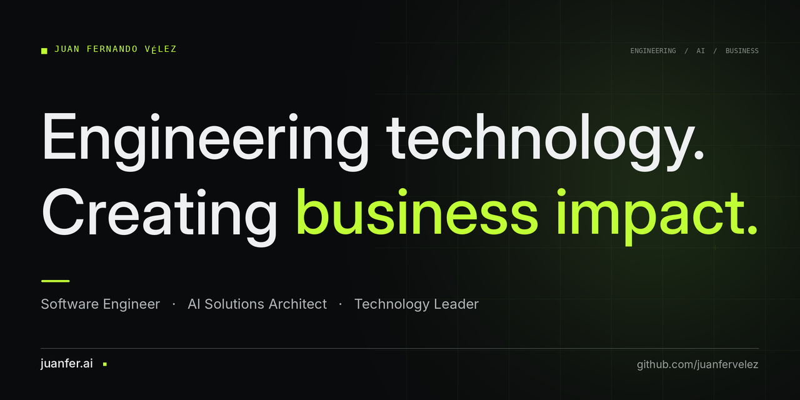

 

**I design and build intelligent products, scalable software, and digital commerce solutions that solve real business problems.**

Systems engineer with 15+ years of experience across software, product development, enterprise technology, and business leadership in Latin America.

[**Personal website**](https://juanfer.ai) &nbsp;·&nbsp; [**MatchFore**](https://matchfore.com) &nbsp;·&nbsp; [**LeadWize**](https://leadwize.app)

---

## About me

I work where **engineering, artificial intelligence, and business strategy** meet.

My career has included building digital solutions, leading technology-driven organizations, and helping companies modernize the way they operate. That experience shapes how I approach software today: understand the underlying problem, make thoughtful architectural decisions, and build products that deliver meaningful value.

I'm particularly interested in **applied AI, intelligent workflows, digital commerce, cloud-native systems, and web and mobile product engineering**. I enjoy working across the entire journey—from discovery and architecture to implementation and iteration.

## What I focus on

| Discipline | Areas of work |
| :--- | :--- |
| **AI engineering** | Conversational agents, document intelligence, LLM-enabled workflows, real-time voice interfaces, and human-in-the-loop systems. |
| **Software & cloud architecture** | Full-stack applications, APIs, integrations, serverless backends, authentication, and data modeling. |
| **Digital commerce** | B2B platforms, product discovery, catalog intelligence, and enterprise digital experiences. |
| **Web & mobile products** | Modern web applications, native and cross-platform mobile experiences, and product-oriented design. |

## Selected projects

A selection of platforms and products I've worked on. Most of the underlying repositories are private; the descriptions below focus on the problems, systems, and engineering approaches behind the work.

### Aegis Commerce Suite
**B2B commerce · Semantic discovery · Product data intelligence**

A modular B2B platform bringing together three complementary capabilities for managing product information and discovery:

- **Search Index:** Semantic product discovery and ranking workflows.
- **Product Intelligence:** Taxonomy management and product enrichment.
- **Crawler:** Web crawling dashboards and execution-log monitoring.

Built as a lightweight monorepo with a **React + Vite** frontend, a **Node.js / Express** API, and **Firebase Authentication**. The interface is designed for responsive, enterprise-oriented workflows.

**Technology:** React · Vite · React Router · Node.js · Express · Firebase Auth · CSS

### [MatchFore](https://matchfore.com)
**Golf technology · Cross-platform apps · Community products**

A product designed to help golfers find compatible playing partners and rounds based on availability, location, and preferences—making it easier to spend less time coordinating and more time playing.

- Native app architecture for **iOS (Swift / SwiftUI)** and **Android (Kotlin / Jetpack Compose)**.
- Web experience built with **React / Next.js**.
- Shared backend services using **Firebase** for authentication, data, storage, and application workflows.

**Technology:** Swift · SwiftUI · Kotlin · Jetpack Compose · React · Next.js · Firebase  
**Website:** [matchfore.com](https://matchfore.com)

### [LeadWize](https://leadwize.app)
**Digital learning · Product design · Human-centered experiences**

A learning platform focused on personal and professional leadership, turning ideas into structured programs, practical reflection, and meaningful action.

- Modular content and program architecture.
- Learning experiences designed around progression, engagement, and application.
- A product approach that balances technology, user experience, and human development.

**Focus:** Product engineering · Learning platforms · UX design  
**Website:** [leadwize.app](https://leadwize.app)

### [juanfer.ai](https://juanfer.ai)
**Applied AI · Technology strategy · Business transformation**

My personal platform for exploring how businesses can move beyond isolated AI experiments and embed intelligent capabilities into real processes.

- Connects AI architecture and implementation with measurable business outcomes.
- Introduces **STRAVAI**, my approach to making AI initiatives strategic, governed, and actionable.
- Brings together my work in software, consulting, and digital transformation.

**Website:** [juanfer.ai](https://juanfer.ai)

### UpCommodity Market Intelligence
**Enterprise CMS · Content platforms · Digital experiences**

A HubSpot CMS experience for a commodity market intelligence offering, built around an **Elevate-based theme** and designed to support publication, discovery, and subscription-oriented content experiences.

- Page and component structure for **market intelligence, plans, publications, reports, and member content**.
- Reusable layouts and conversion paths for **lead capture, waitlists, newsletters, and gated resources**.
- A planned integration path for **Market Desk AI**, alongside membership and access-control experiences.

**Platform:** HubSpot CMS · HubSpot Elevate · Theme customization · Reusable CMS modules

### MORIANE AI Discovery Agent
**Conversational AI · Requirements engineering · Document intelligence**  
*Phase 1 proof of concept*

An AI-powered discovery consultant designed to turn client briefs and technical questionnaires into structured, traceable requirements through natural voice and text conversations.

- Ingests **PDFs, DOCX files, websites, and text**, extracting discovery topics and separating documented facts from unanswered questions.
- Supports bilingual interviews in **English and Latin American Spanish**, using the **OpenAI Realtime API over WebRTC**, with text fallback and participant-consent checks.
- Captures evidence-linked answers, identifies gaps and contradictions, creates follow-up tasks, and prepares executive summaries and structured exports.
- Maintains context across sessions so discovery can continue without starting over.

**Technology:** Next.js · Node.js · Firebase · OpenAI APIs · WebRTC

### ChefGo
**AI-assisted personalization · Mobile commerce · Subscription systems**

A mobile-first product for personalized meal planning and delivery, designed around dietary preferences, nutritional goals, allergies, and flexible meal subscriptions.

- **Mobile experience:** React Native and Expo application for onboarding, meal planning, account management, addresses, and subscription flows.
- **Payments & subscriptions:** Stripe integration and Firebase Cloud Functions supporting payment initiation, subscription confirmation, renewals, and cancellation.
- **Backend:** Firebase Authentication, Firestore, Storage, and App Check, with scheduled functions for recurring operations.
- **Roadmap:** AI-generated weekly menus, delivery tracking, a web experience, and administration capabilities.

**Technology:** React Native · Expo Router · Firebase · Cloud Functions · Stripe · Next.js (planned web app)

## Technologies across my projects

**Languages:** TypeScript · JavaScript · Swift · Kotlin  
**Web & mobile:** React · Next.js · Vite · React Native · Expo · SwiftUI · Jetpack Compose  
**Backend & cloud:** Node.js · Express · Firebase · Firestore · Cloud Functions · Google Cloud  
**AI & real-time:** OpenAI APIs · Realtime API · WebRTC · Document-processing workflows  
**Commerce & platforms:** Stripe · HubSpot CMS · Enterprise integrations

## How I approach engineering

**Start with the problem.** Understand the people, processes, and outcomes before selecting tools.

**Design deliberately.** Favor clarity, security, maintainability, and systems that can evolve.

**Apply AI where it belongs.** Make intelligence useful, observable, and accountable—not merely impressive in a demo.

**Bridge strategy and execution.** Connect high-level objectives with working software and measurable results.

## About the private repositories

Much of my work is developed in **private repositories** because it involves products in progress, client projects, or confidential implementations. This profile shares selected technical work and architectural context without exposing private source code or sensitive project information.

---

### Let's connect

Interested in **AI, software architecture, digital commerce, or building ambitious products**?

**[Explore my work at juanfer.ai](https://juanfer.ai)**

Based in Mexico · Working across Latin America

